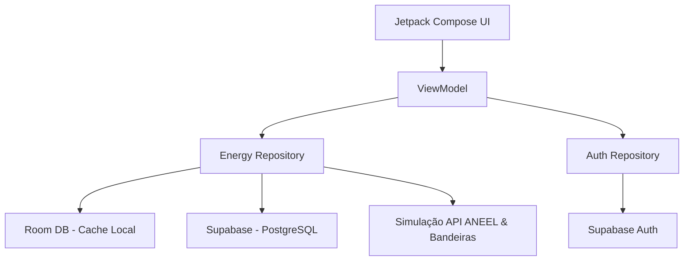
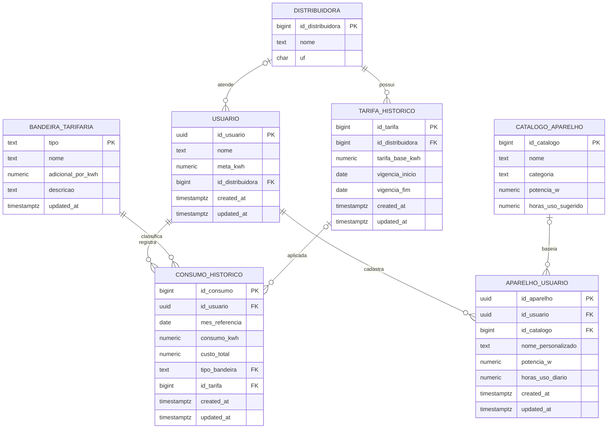

# Energia Inteligente 

O **Energia Inteligente** é um aplicativo Android desenvolvido com Jetpack Compose focado no monitoramento e previsão de gastos com energia elétrica de forma precisa, resiliente (Offline-First) e inteligente.

O aplicativo utiliza dados em tempo real da **ANEEL** (Tarifas e Bandeiras) e geolocalização automática para entregar ao usuário o custo exato do consumo de seus eletrodomésticos, integrando-se à nuvem via **Supabase**.

---

##  Principais Funcionalidades

- **Cálculo de Consumo Real**: Baseado nas fórmulas de engenharia elétrica, considerando potência (W) e tempo de uso.
- **Detecção Automática de Região (GPS)**: Identifica o Estado (UF) e sugere as distribuidoras de energia locais.
- **Integração ANEEL & Bandeiras**: Aplicação automática de tarifas base (TE + TUSD) e adicionais de bandeiras (Verde, Amarela, Vermelha).
- **Cálculo de Impostos Estaduais**: Cálculo preciso de ICMS baseado na UF detectada.
- **Modo Offline-First**: O app funciona 100% sem internet utilizando banco de dados local **Room**, sincronizando com o **Supabase/PostgreSQL** assim que a conexão retorna.
- **Dark Mode Premium**: Interface moderna projetada para eficiência energética e conforto visual.

---

##  Arquitetura Técnica

O projeto segue a arquitetura **MVVM (Model-View-ViewModel)** recomendada pelo Google:

### Tecnologias Utilizadas:
- **UI**: Jetpack Compose (Declarative UI)
- **Banco Local**: Room Persistence Library
- **Backend/Auth**: Supabase (PostgreSQL + Auth)
- **Localização**: Fused Location Provider API & Geocoder
- **Sincronização**: WorkManager (Android Jetpack)
- **Rede**: Ktor Client

---

## Banco de Dados

O banco é **PostgreSQL**, hospedado no **Supabase**. O app Android não se conecta direto ao banco: ele usa a API e o login (Auth) do Supabase, e as regras de acesso (Row Level Security) ficam no próprio banco. Os scripts estão na pasta `database/`.

### Arquivos

| Arquivo | O que tem | Onde rodar |
|---|---|---|
| `database/schema.sql` | Estrutura: 7 tabelas, função e triggers de `updated_at`, índices | Qualquer PostgreSQL |
| `database/seed.sql` | Dados de referência: distribuidora, bandeiras, tarifa, catálogo de aparelhos | Qualquer PostgreSQL |
| `database/supabase.sql` | Específico do Supabase: ligação com `auth.users`, RLS, permissões, criação automática do usuário no cadastro | Só no Supabase |

**Ordem para recriar o banco**

- PostgreSQL local: `schema.sql` e depois `seed.sql`.
- Supabase (SQL Editor): `schema.sql`, `seed.sql` e `supabase.sql`.

> O `schema.sql` começa com `DROP TABLE`, então **apaga os dados**. Não rodar de novo no Supabase quando já houver usuários reais.

### Diagrama ER

### Dicionário de dados

**`distribuidora`**: distribuidoras de energia por estado.

| Coluna | Tipo | Regras | Descrição |
|---|---|---|---|
| `id_distribuidora` | BIGINT | PK, identity | Identificador numerado pelo banco |
| `nome` | TEXT | NOT NULL | Nome da distribuidora |
| `uf` | CHAR(2) | NOT NULL | Estado (ex.: PA) |

Restrição: `UNIQUE (nome, uf)`.

**`catalogo_aparelho`**: aparelhos sugeridos para o usuário escolher.

| Coluna | Tipo | Regras | Descrição |
|---|---|---|---|
| `id_catalogo` | BIGINT | PK, identity | Identificador |
| `nome` | TEXT | NOT NULL, UNIQUE | Nome do aparelho |
| `categoria` | TEXT | opcional | Ex.: Cozinha, Climatização |
| `potencia_w` | NUMERIC(10,2) | NOT NULL, > 0 | Potência típica em watts |
| `horas_uso_sugerido` | NUMERIC(4,1) | 0 a 24 | Horas de uso por dia sugeridas |

**`bandeira_tarifaria`**: as 4 bandeiras da ANEEL.

| Coluna | Tipo | Regras | Descrição |
|---|---|---|---|
| `tipo` | TEXT | PK, CHECK | `VERDE`, `AMARELA`, `VERMELHA_P1` ou `VERMELHA_P2` |
| `nome` | TEXT | NOT NULL | Nome exibido |
| `adicional_por_kwh` | NUMERIC(8,5) | NOT NULL, >= 0 | Adicional em R$/kWh |
| `descricao` | TEXT | opcional | Explicação da bandeira |
| `updated_at` | TIMESTAMPTZ | NOT NULL, default `now()` | Última alteração (automática) |

**`usuario`**: perfil de quem usa o app. Login, e-mail e senha ficam no Supabase Auth, não aqui.

| Coluna | Tipo | Regras | Descrição |
|---|---|---|---|
| `id_usuario` | UUID | PK; no Supabase, FK para `auth.users` (CASCADE) | Mesmo id da conta de login |
| `nome` | TEXT | NOT NULL | Nome do usuário |
| `meta_kwh` | NUMERIC(10,2) | >= 0, opcional | Meta mensal de consumo |
| `id_distribuidora` | BIGINT | FK, ON DELETE SET NULL, opcional | Distribuidora do usuário |
| `created_at`, `updated_at` | TIMESTAMPTZ | NOT NULL, default `now()` | Controle e sincronização |

**`tarifa_historico`**: tarifa base de cada distribuidora ao longo do tempo.

| Coluna | Tipo | Regras | Descrição |
|---|---|---|---|
| `id_tarifa` | BIGINT | PK, identity | Identificador |
| `id_distribuidora` | BIGINT | FK NOT NULL, ON DELETE CASCADE | Distribuidora |
| `tarifa_base_kwh` | NUMERIC(8,5) | NOT NULL, >= 0 | Tarifa base em R$/kWh |
| `vigencia_inicio` | DATE | NOT NULL | Início da vigência |
| `vigencia_fim` | DATE | opcional | Fim da vigência (vazio = em vigor) |
| `created_at`, `updated_at` | TIMESTAMPTZ | NOT NULL, default `now()` | Controle e sincronização |

Restrição: `CHECK (vigencia_fim >= vigencia_inicio)`.

**`aparelho_usuario`**: aparelhos cadastrados por cada usuário.

| Coluna | Tipo | Regras | Descrição |
|---|---|---|---|
| `id_aparelho` | UUID | PK, default `gen_random_uuid()` | Pode ser gerado no app, mesmo offline |
| `id_usuario` | UUID | FK NOT NULL, ON DELETE CASCADE | Dono do aparelho |
| `id_catalogo` | BIGINT | FK, ON DELETE SET NULL, opcional | Aparelho do catálogo que originou este |
| `nome_personalizado` | TEXT | NOT NULL | Nome dado pelo usuário |
| `potencia_w` | NUMERIC(10,2) | NOT NULL, > 0 | Potência em watts (valor próprio, independe do catálogo) |
| `horas_uso_diario` | NUMERIC(4,1) | NOT NULL, 0 a 24 | Horas de uso por dia (aceita decimal) |
| `created_at`, `updated_at` | TIMESTAMPTZ | NOT NULL, default `now()` | Controle e sincronização |

**`consumo_historico`**: consumo e custo de cada mês, por usuário.

| Coluna | Tipo | Regras | Descrição |
|---|---|---|---|
| `id_consumo` | BIGINT | PK, identity | Identificador |
| `id_usuario` | UUID | FK NOT NULL, ON DELETE CASCADE | Usuário |
| `mes_referencia` | DATE | NOT NULL, dia = 1 | Mês de referência (sempre o dia 1) |
| `consumo_kwh` | NUMERIC(10,2) | NOT NULL, >= 0 | Consumo do mês |
| `custo_total` | NUMERIC(10,2) | NOT NULL, >= 0 | Custo do mês, congelado na época |
| `tipo_bandeira` | TEXT | FK NOT NULL | Bandeira vigente no mês |
| `id_tarifa` | BIGINT | FK, ON DELETE SET NULL, opcional | Tarifa aplicada |
| `created_at`, `updated_at` | TIMESTAMPTZ | NOT NULL, default `now()` | Controle e sincronização |

Restrição: `UNIQUE (id_usuario, mes_referencia)` (um registro por usuário em cada mês).

### Decisões de modelagem

- **`NUMERIC` e não `FLOAT`** para tarifa, potência e dinheiro: valor exato, sem erro de arredondamento.
- **UUID** nos dados que podem nascer no app sem internet (`usuario`, `aparelho_usuario`); **números identity** nos dados criados no servidor.
- **`ON DELETE`**: `CASCADE` quando o filho não faz sentido sem o pai (aparelhos e consumos de um usuário); `SET NULL` quando o filho existe por conta própria (usuário sem distribuidora, consumo sem tarifa); bandeira em uso não pode ser apagada.
- **Dados repetidos de propósito**: `aparelho_usuario.potencia_w` e `consumo_historico.custo_total` guardam o valor do momento, para o histórico não mudar quando o catálogo ou a tarifa mudarem.
- **`updated_at` automático** por trigger em toda alteração, usado pelo app para sincronizar mudanças (cache offline com Room).
- **Índices** nas chaves estrangeiras.

### Segurança (Row Level Security)

O RLS está ligado em todas as tabelas. Sem política escrita, o acesso é negado.

| Tabelas | Quem acessa | O quê |
|---|---|---|
| `distribuidora`, `catalogo_aparelho`, `bandeira_tarifaria`, `tarifa_historico` | Usuário logado | Só leitura |
| `usuario` | Usuário logado | Ler, criar e editar apenas a própria linha |
| `aparelho_usuario`, `consumo_historico` | Usuário logado | Ler, criar, editar e apagar apenas as próprias linhas |

O perfil em `usuario` é criado automaticamente por um trigger quando a conta é criada no Supabase Auth. O app deve enviar o nome no metadado `nome` do cadastro (`signUp`).

### Conexão do app

O app usa a **URL do projeto** e a chave **publishable** do Supabase. Essas informações ficam no `local.properties` (fora do Git). A chave **secret** e a senha do banco nunca entram no app nem no repositório.

## 🎨 Guia de Estilo (UI)

- **Fundo**: `#0C0F12`
- **Cards**: `#161B22`
- **Primária**: `#00E676` (Verde Elétrico)
- **Texto**: `#FFFFFF` / `#8B949E`

---

