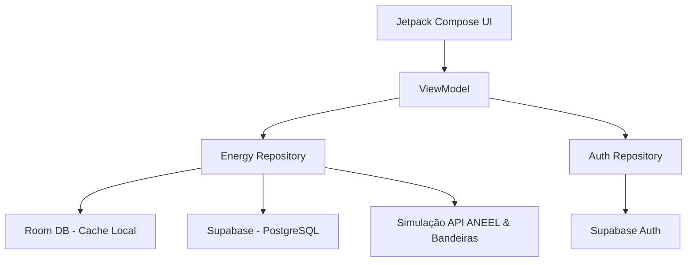
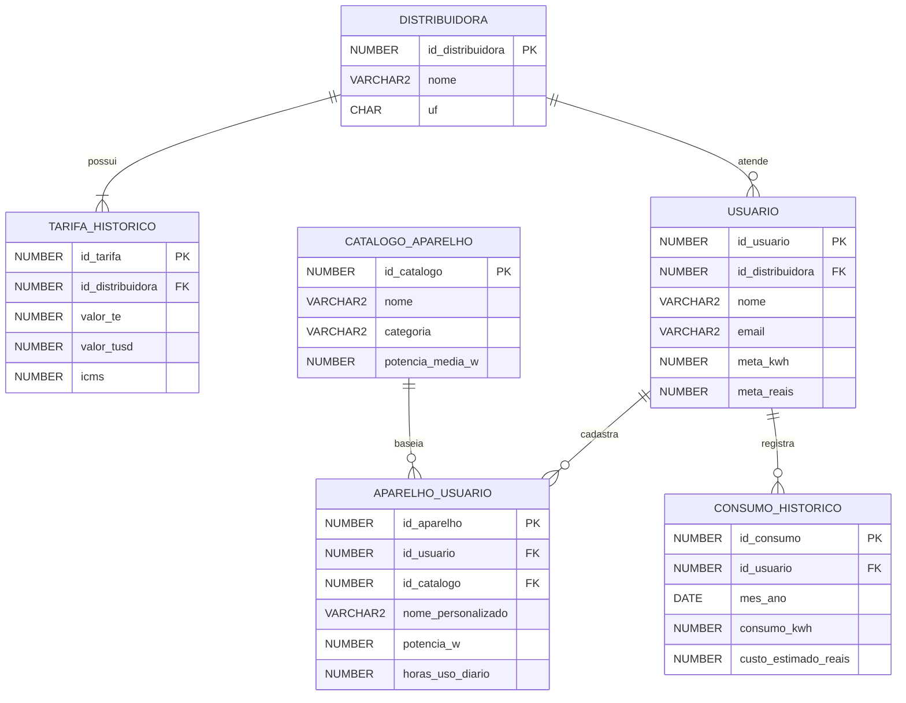

# Energia Inteligente 

O **Energia Inteligente** é um aplicativo Android desenvolvido com Jetpack Compose focado no monitoramento e previsão de gastos com energia elétrica de forma precisa, resiliente (Offline-First) e inteligente.

O aplicativo utiliza dados em tempo real da **ANEEL** (Tarifas e Bandeiras) e geolocalização automática para entregar ao usuário o custo exato do consumo de seus eletrodomésticos, integrando-se à nuvem via **Supabase**.

---

##  Principais Funcionalidades

- **Cálculo de Consumo Real**: Baseado nas fórmulas de engenharia elétrica, considerando potência (W) e tempo de uso.
- **Detecção Automática de Região (GPS)**: Identifica o Estado (UF) e sugere as distribuidoras de energia locais.
- **Integração ANEEL & Bandeiras**: Aplicação automática de tarifas base (TE + TUSD) e adicionais de bandeiras (Verde, Amarela, Vermelha).
- **Cálculo de Impostos Estaduais**: Cálculo preciso de ICMS baseado na UF detectada.
- **Modo Offline-First**: O app funciona 100% sem internet utilizando banco de dados local **Room**, sincronizando com o **Supabase/PostgreSQL** assim que a conexão retorna.
- **Dark Mode Premium**: Interface moderna projetada para eficiência energética e conforto visual.

---

##  Arquitetura Técnica

O projeto segue a arquitetura **MVVM (Model-View-ViewModel)** recomendada pelo Google:



### Tecnologias Utilizadas:
- **UI**: Jetpack Compose (Declarative UI)
- **Banco Local**: Room Persistence Library
- **Backend/Auth**: Supabase (PostgreSQL + Auth)
- **Localização**: Fused Location Provider API & Geocoder
- **Sincronização**: WorkManager (Android Jetpack)
- **Rede**: Ktor Client

---

##  Modelo de Dados (ER)

O banco de dados foi projetado para suportar histórico de consumo e catálogo de aparelhos sugeridos:

## 🗄️ Banco de Dados

O Energia Inteligente utiliza **Oracle Database XE** como SGBD (com **Oracle APEX/ORDS** como opção para expor os dados via REST). O modelo suporta o cálculo financeiro do consumo (TE, TUSD e tributos), o histórico mensal de consumo e um catálogo de aparelhos sugeridos.

### Modelo Entidade-Relacionamento



### Relacionamentos

| Relação | Cardinalidade | Descrição |
|---|---|---|
| Distribuidora → Tarifa_Historico | 1:N | Cada distribuidora possui várias versões de tarifa ao longo do tempo |
| Distribuidora → Usuario | 1:N | Uma distribuidora atende vários usuários (definida pela UF/região) |
| Usuario → Aparelho_Usuario | 1:N | O usuário cadastra seus eletrodomésticos |
| Usuario → Consumo_Historico | 1:N | Um registro de consumo por mês para cada usuário |
| Catalogo_Aparelho → Aparelho_Usuario | 1:N | O aparelho do usuário pode ser baseado em um item do catálogo (opcional) |

### Dicionário de dados

#### `DISTRIBUIDORA`
| Coluna | Tipo Oracle | Restrições | Descrição |
|---|---|---|---|
| `id_distribuidora` | `NUMBER` (IDENTITY) | PK | Identificador |
| `nome` | `VARCHAR2(100)` | NOT NULL | Ex.: Equatorial Pará |
| `uf` | `CHAR(2)` | NOT NULL | Estado de atuação |

#### `TARIFA_HISTORICO`
| Coluna | Tipo Oracle | Restrições | Descrição |
|---|---|---|---|
| `id_tarifa` | `NUMBER` (IDENTITY) | PK | Identificador |
| `id_distribuidora` | `NUMBER` | FK, NOT NULL | Distribuidora da tarifa |
| `valor_te` | `NUMBER(10,6)` | NOT NULL | Tarifa de Energia (R$/kWh) |
| `valor_tusd` | `NUMBER(10,6)` | NOT NULL | Tarifa de Uso do Sistema de Distribuição (R$/kWh) |
| `icms` | `NUMBER(5,2)` | NOT NULL | Alíquota de ICMS (%) |
| *bandeira* | `VARCHAR2(20)` | *(planejado)* | Bandeira tarifária vigente |
| *pis_cofins* | `NUMBER(5,2)` | *(planejado)* | Alíquotas de PIS/COFINS (%) |
| *vigencia_inicio* | `DATE` | *(planejado)* | Data de início da vigência |

#### `USUARIO`
| Coluna | Tipo Oracle | Restrições | Descrição |
|---|---|---|---|
| `id_usuario` | `NUMBER` (IDENTITY) | PK | Identificador |
| `id_distribuidora` | `NUMBER` | FK | Distribuidora que atende o usuário |
| `nome` | `VARCHAR2(100)` | NOT NULL | Nome do usuário |
| `email` | `VARCHAR2(150)` | NOT NULL, UNIQUE | E-mail de login |
| `meta_kwh` | `NUMBER(10,2)` | | Meta mensal de consumo (kWh) |
| `meta_reais` | `NUMBER(10,2)` | | Meta mensal de gasto (R$) |
| *senha_hash* | `VARCHAR2(255)` | *(planejado)* | Hash da senha (nunca em texto puro) |

#### `CATALOGO_APARELHO`
| Coluna | Tipo Oracle | Restrições | Descrição |
|---|---|---|---|
| `id_catalogo` | `NUMBER` (IDENTITY) | PK | Identificador |
| `nome` | `VARCHAR2(100)` | NOT NULL | Ex.: Geladeira, Ar-condicionado |
| `categoria` | `VARCHAR2(50)` | NOT NULL | Categoria do aparelho |
| `potencia_media_w` | `NUMBER(8,2)` | NOT NULL | Potência média sugerida (W) |

#### `APARELHO_USUARIO`
| Coluna | Tipo Oracle | Restrições | Descrição |
|---|---|---|---|
| `id_aparelho` | `NUMBER` (IDENTITY) | PK | Identificador |
| `id_usuario` | `NUMBER` | FK, NOT NULL | Dono do aparelho |
| `id_catalogo` | `NUMBER` | FK, NULL | Item do catálogo usado como base |
| `nome_personalizado` | `VARCHAR2(100)` | NOT NULL | Nome dado pelo usuário |
| `potencia_w` | `NUMBER(8,2)` | NOT NULL, `> 0` | Potência do aparelho (W) |
| `horas_uso_diario` | `NUMBER(2)` | NOT NULL, `0–24` | Horas de uso por dia |

#### `CONSUMO_HISTORICO`
| Coluna | Tipo Oracle | Restrições | Descrição |
|---|---|---|---|
| `id_consumo` | `NUMBER` (IDENTITY) | PK | Identificador |
| `id_usuario` | `NUMBER` | FK, NOT NULL | Usuário do registro |
| `mes_ano` | `DATE` | NOT NULL | Primeiro dia do mês de referência |
| `consumo_kwh` | `NUMBER(10,2)` | NOT NULL | Consumo no mês (kWh) |
| `custo_estimado_reais` | `NUMBER(10,2)` | NOT NULL | Custo estimado da fatura (R$) |

> Restrição sugerida: `UNIQUE (id_usuario, mes_ano)` para impedir dois registros do mesmo mês para o mesmo usuário.

### Regras de negócio

- **Consumo mensal do aparelho (kWh)** = `potencia_w × horas_uso_diario × dias_no_mês ÷ 1000`
- **Custo estimado (R$)** = `consumo_kwh × (TE + TUSD)`, acrescido da bandeira tarifária e dos tributos (ICMS, PIS e COFINS).
- Os valores monetários usam `NUMBER(p,s)`, e não `FLOAT`, para evitar erros de arredondamento.
- O **ranking dos "vilões"** é calculado pela participação percentual de cada aparelho no consumo total do usuário.

### Convenções

- Chaves primárias: `NUMBER GENERATED ALWAYS AS IDENTITY`
- Nomes de tabelas e colunas em `snake_case` (o Oracle armazena em maiúsculas)
- Constraints nomeadas: `PK_<tabela>`, `FK_<tabela>_<referência>`, `UK_<tabela>_<coluna>`

### Scripts

```
database/
├── 01_tabelas.sql        # CREATE TABLE + constraints
├── 02_indices.sql        # Índices
└── 03_carga_inicial.sql  # Distribuidoras, catálogo e tarifas iniciais
```

Para executar em um Oracle XE local (por exemplo, via SQLcl ou SQL*Plus):

```sql
@database/01_tabelas.sql
@database/02_indices.sql
@database/03_carga_inicial.sql
```

---

## 🎨 Guia de Estilo (UI)

- **Fundo**: `#0C0F12`
- **Cards**: `#161B22`
- **Primária**: `#00E676` (Verde Elétrico)
- **Texto**: `#FFFFFF` / `#8B949E`

---

