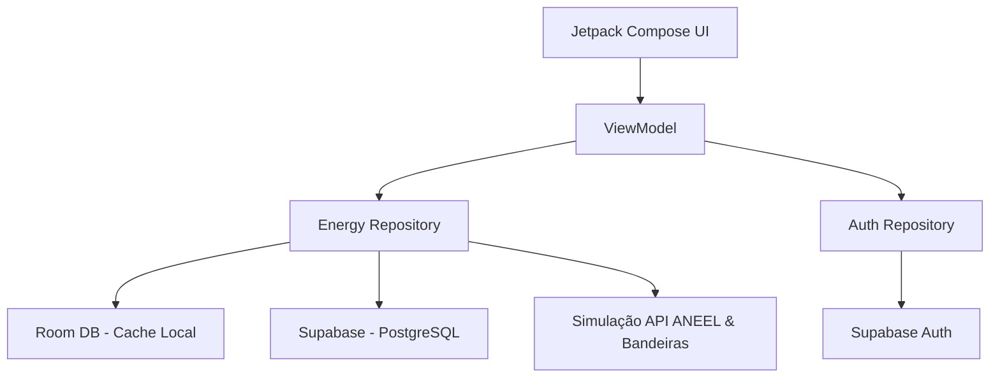
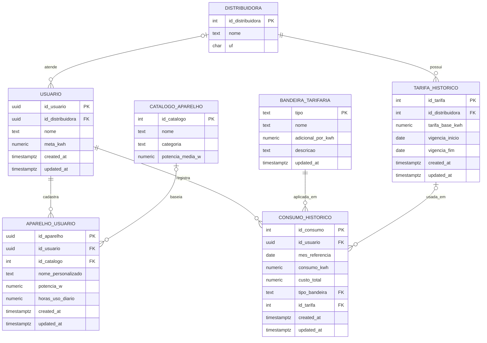

# Energia Inteligente 

O **Energia Inteligente** é um aplicativo Android desenvolvido com Jetpack Compose focado no monitoramento e previsão de gastos com energia elétrica de forma precisa, resiliente (Offline-First) e inteligente.

O aplicativo utiliza dados em tempo real da **ANEEL** (Tarifas e Bandeiras) e geolocalização automática para entregar ao usuário o custo exato do consumo de seus eletrodomésticos, integrando-se à nuvem via **Supabase**.

---

##  Principais Funcionalidades

- **Cálculo de Consumo Real**: Baseado nas fórmulas de engenharia elétrica, considerando potência (W) e tempo de uso.
- **Detecção Automática de Região (GPS)**: Identifica o Estado (UF) e sugere as distribuidoras de energia locais.
- **Integração ANEEL & Bandeiras**: Aplicação automática de tarifas base (TE + TUSD) e adicionais de bandeiras (Verde, Amarela, Vermelha).
- **Cálculo de Impostos Estaduais**: Cálculo preciso de ICMS baseado na UF detectada.
- **Modo Offline-First**: O app funciona 100% sem internet utilizando banco de dados local **Room**, sincronizando com o **Supabase/PostgreSQL** assim que a conexão retorna.
- **Dark Mode Premium**: Interface moderna projetada para eficiência energética e conforto visual.

---

##  Arquitetura Técnica

O projeto segue a arquitetura **MVVM (Model-View-ViewModel)** recomendada pelo Google:



### Tecnologias Utilizadas:
- **UI**: Jetpack Compose (Declarative UI)
- **Banco Local**: Room Persistence Library
- **Backend/Auth**: Supabase (PostgreSQL + Auth)
- **Localização**: Fused Location Provider API & Geocoder
- **Sincronização**: WorkManager (Android Jetpack)
- **Rede**: Ktor Client

---

##  Modelo de Dados (ER)

O banco de dados foi projetado para suportar histórico de consumo e catálogo de aparelhos sugeridos:

## 🗄️ Banco de Dados

O Energia Inteligente usa **PostgreSQL** hospedado no **Supabase**, que também fornece a autenticação (Supabase Auth) e uma API REST sobre as tabelas. O modelo suporta o cálculo financeiro do consumo (tarifa base, bandeira tarifária e tributos), o histórico mensal de consumo e um catálogo de aparelhos sugeridos.

> 🚧 Modelo em construção. Tabelas marcadas com ⚠️ ainda precisam ser conferidas com o `database/schema.sql`.

### Modelo Entidade-Relacionamento



### Relacionamentos

| Relação | Cardinalidade | Descrição |
|---|---|---|
| Distribuidora → Tarifa_Historico | 1:N | Cada distribuidora tem várias tarifas ao longo do tempo |
| Distribuidora → Usuario | 1:N (opcional) | Uma distribuidora atende vários usuários; o usuário pode ainda não ter escolhido uma |
| Usuario → Aparelho_Usuario | 1:N | O usuário cadastra seus eletrodomésticos |
| Usuario → Consumo_Historico | 1:N | Um registro de consumo por mês para cada usuário |
| Catalogo_Aparelho → Aparelho_Usuario | 1:N (opcional) | O aparelho do usuário pode ser baseado em um item do catálogo |
| Bandeira_Tarifaria → Consumo_Historico | 1:N | Cada mês registra a bandeira vigente |
| Tarifa_Historico → Consumo_Historico | 1:N (opcional) | Cada mês registra qual tarifa foi usada no cálculo |

### Dicionário de dados

#### `distribuidora` ⚠️
Distribuidoras de energia por estado (ex.: Equatorial Pará, PA). Colunas a conferir com o `schema.sql`.

#### `catalogo_aparelho` ⚠️
Catálogo de aparelhos sugeridos (ex.: Geladeira, Cozinha, 150 W). Colunas a conferir com o `schema.sql`.

#### `bandeira_tarifaria`
| Coluna | Tipo | Restrições | Descrição |
|---|---|---|---|
| `tipo` | `TEXT` | PK, CHECK (`VERDE`, `AMARELA`, `VERMELHA_P1`, `VERMELHA_P2`) | Tipo da bandeira |
| `nome` | `TEXT` | NOT NULL | Nome de exibição |
| `adicional_por_kwh` | `NUMERIC(8,5)` | NOT NULL, `>= 0` | Adicional em R$/kWh |
| `descricao` | `TEXT` | | Texto explicativo |
| `updated_at` | `TIMESTAMPTZ` | default `now()` | Última alteração |

#### `usuario`
| Coluna | Tipo | Restrições | Descrição |
|---|---|---|---|
| `id_usuario` | `UUID` | PK | Mesmo id do login no Supabase Auth |
| `nome` | `TEXT` | | Nome do usuário |
| `meta_kwh` | `NUMERIC(10,2)` | `>= 0` | Meta mensal de consumo (kWh) |
| `id_distribuidora` | FK | `ON DELETE SET NULL` | Distribuidora que atende o usuário |
| `created_at`, `updated_at` | `TIMESTAMPTZ` | | Controle de criação e alteração |

#### `tarifa_historico`
| Coluna | Tipo | Restrições | Descrição |
|---|---|---|---|
| `id_tarifa` | identity | PK | Identificador |
| `id_distribuidora` | FK | `ON DELETE CASCADE` | Distribuidora da tarifa |
| `tarifa_base_kwh` | `NUMERIC(8,5)` | `>= 0` | Tarifa base em R$/kWh |
| `vigencia_inicio` | `DATE` | | Início da vigência |
| `vigencia_fim` | `DATE` | NULL = em vigor; `fim >= início` | Fim da vigência |
| `created_at`, `updated_at` | `TIMESTAMPTZ` | | Controle de criação e alteração |

#### `aparelho_usuario`
| Coluna | Tipo | Restrições | Descrição |
|---|---|---|---|
| `id_aparelho` | `UUID` | PK, default `gen_random_uuid()` | Identificador |
| `id_usuario` | FK | `ON DELETE CASCADE` | Dono do aparelho |
| `id_catalogo` | FK | `ON DELETE SET NULL` | Item do catálogo usado como base |
| `nome_personalizado` | `TEXT` | | Nome dado pelo usuário |
| `potencia_w` | `NUMERIC(10,2)` | `> 0` | Potência (W) |
| `horas_uso_diario` | `NUMERIC(4,1)` | entre 0 e 24 | Horas de uso por dia |
| `created_at`, `updated_at` | `TIMESTAMPTZ` | | Controle de criação e alteração |

#### `consumo_historico`
| Coluna | Tipo | Restrições | Descrição |
|---|---|---|---|
| `id_consumo` | identity | PK | Identificador |
| `id_usuario` | FK | `ON DELETE CASCADE` | Usuário do registro |
| `mes_referencia` | `DATE` | sempre dia 1 | Mês de referência |
| `consumo_kwh` | `NUMERIC(10,2)` | `>= 0` | Consumo no mês (kWh) |
| `custo_total` | `NUMERIC(10,2)` | `>= 0` | Custo da fatura (R$) |
| `tipo_bandeira` | FK | | Bandeira vigente no mês |
| `id_tarifa` | FK | `ON DELETE SET NULL` | Tarifa usada no cálculo |
| `created_at`, `updated_at` | `TIMESTAMPTZ` | | Controle de criação e alteração |

`UNIQUE (id_usuario, mes_referencia)` impede dois registros do mesmo mês para o mesmo usuário.

### Regras de negócio

- **Consumo mensal do aparelho (kWh)** = `potencia_w × horas_uso_diario × dias_no_mês ÷ 1000`
- **Custo estimado (R$)** = `consumo_kwh × (tarifa_base + adicional da bandeira)`, acrescido de tributos. O ICMS ainda é calculado no app (decisão em aberto).
- Valores monetários e tarifas usam `NUMERIC(p,s)`, e não `FLOAT`, para evitar erros de arredondamento.
- O **ranking dos "vilões"** é calculado pela participação percentual de cada aparelho no consumo total do usuário.
- **Senhas não ficam em tabelas do projeto**: o login é feito pelo Supabase Auth.

### Convenções

- Nomes de tabelas e colunas em `snake_case`
- Chaves primárias numéricas: `GENERATED ALWAYS AS IDENTITY`; usuários e aparelhos do usuário usam `UUID`
- Datas e horas com fuso: `TIMESTAMPTZ`
- Colunas `updated_at` preenchidas por trigger, para apoiar a sincronização com o Room

### Scripts

```
database/
├── schema.sql   # estrutura: DROP TABLE e CREATE TABLE
└── seed.sql     # dados iniciais: distribuidoras, bandeiras, tarifas, catálogo
```

Para recriar o banco em um PostgreSQL local (o `schema.sql` deve rodar antes do `seed.sql`):

```bash
psql -U postgres -d energia_teste -f database/schema.sql
psql -U postgres -d energia_teste -f database/seed.sql
```

No Supabase, os mesmos arquivos podem ser executados pelo SQL Editor.
### Regras de negócio

- **Consumo mensal do aparelho (kWh)** = `potencia_w × horas_uso_diario × dias_no_mês ÷ 1000`
- **Custo estimado (R$)** = `consumo_kwh × (TE + TUSD)`, acrescido da bandeira tarifária e dos tributos (ICMS, PIS e COFINS).
- Os valores monetários usam `NUMBER(p,s)`, e não `FLOAT`, para evitar erros de arredondamento.
- O **ranking dos "vilões"** é calculado pela participação percentual de cada aparelho no consumo total do usuário.

### Convenções

- Chaves primárias: `NUMBER GENERATED ALWAYS AS IDENTITY`
- Nomes de tabelas e colunas em `snake_case` (o Oracle armazena em maiúsculas)
- Constraints nomeadas: `PK_<tabela>`, `FK_<tabela>_<referência>`, `UK_<tabela>_<coluna>`

### Scripts

```
database/
├── 01_tabelas.sql        # CREATE TABLE + constraints
├── 02_indices.sql        # Índices
└── 03_carga_inicial.sql  # Distribuidoras, catálogo e tarifas iniciais
```

Para executar em um Oracle XE local (por exemplo, via SQLcl ou SQL*Plus):

```sql
@database/01_tabelas.sql
@database/02_indices.sql
@database/03_carga_inicial.sql
```

---

## 🎨 Guia de Estilo (UI)

- **Fundo**: `#0C0F12`
- **Cards**: `#161B22`
- **Primária**: `#00E676` (Verde Elétrico)
- **Texto**: `#FFFFFF` / `#8B949E`

---

